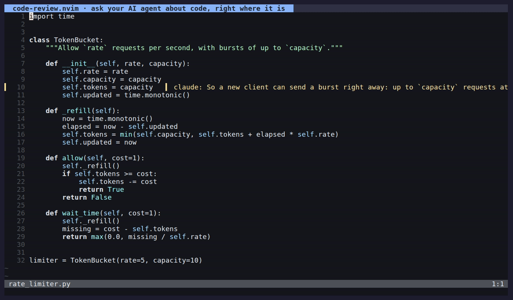
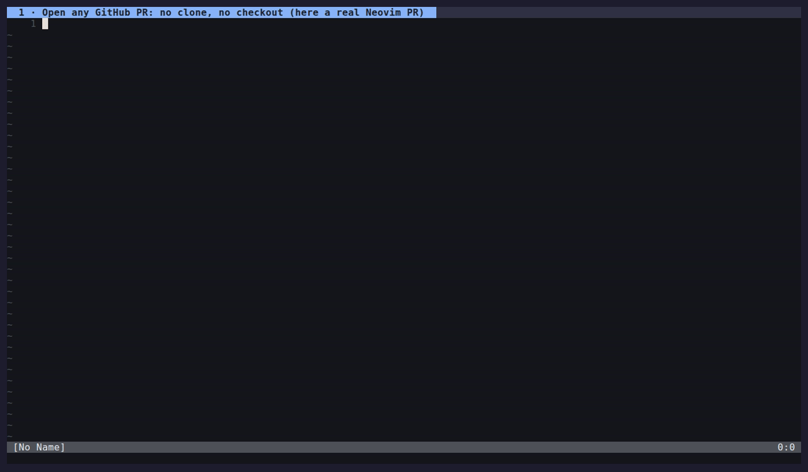

# code-review.nvim

Leave review comments on code in Neovim; AI agents read them, reply in threads,
and resolve them through a small CLI. Threads live in a plain JSON file, so any
agent that can run a shell command can take part — no MCP server or daemon.

Inspired by [hunk](https://github.com/modem-dev/hunk).



## Install

Requires Neovim ≥ 0.10. No dependencies; PR reviews also need `curl`.
Optional: [fzf-lua](https://github.com/ibhagwan/fzf-lua) (pickers with preview),
[nvim-web-devicons](https://github.com/nvim-tree/nvim-web-devicons) (file icons),
[herdr](https://herdr.dev) (poke agents running in other panes).

```lua
-- lazy.nvim
{ "muzomer/code-review.nvim", opts = {} }

-- vim.pack (Neovim ≥ 0.12)
vim.pack.add({ "https://github.com/muzomer/code-review.nvim" })
require("code-review").setup()
```

For agents running outside Neovim, put `bin/code-review` on your `PATH`. The
plugin directory depends on your plugin manager:

```sh
# lazy.nvim
ln -s ~/.local/share/nvim/lazy/code-review.nvim/bin/code-review ~/.local/bin/
# vim.pack
ln -s ~/.local/share/nvim/site/pack/core/opt/code-review.nvim/bin/code-review ~/.local/bin/
```

Inside Neovim the plugin prepends `bin/` to `$PATH` for you, so agents started
from `:terminal` find it.

## Usage in Neovim

| Key / command                                          | Action                                                                                                       |
| ------------------------------------------------------ | ------------------------------------------------------------------------------------------------------------ |
| `<leader>ca` (normal / visual)                         | comment on the line; in visual mode `v` on the selected text, `V` on the selected lines                      |
| `<leader>cr`                                           | open the thread under the cursor; with several on the line, the one whose text you are on, else a picker     |
| `<leader>ce` (`:CodeReview edit`)                      | edit your last comment of the thread under the cursor, until the agent replies                               |
| `<leader>cx`                                           | resolve / reopen the thread under the cursor                                                                 |
| `<leader>cy` (`:CodeReview approve`)                   | approve one code change for the thread, sent at once (again: withdraw); see [Discuss first](#discuss-first)  |
| `:CodeReview delete`                                   | delete the thread under the cursor                                                                           |
| `]r` / `[r`                                            | next / previous thread in the buffer, one stop per thread (wraps, takes a count)                             |
| `]u` / `[u`                                            | next / previous thread waiting for you (the agent replied), across files                                     |
| `<C-l>` or `<leader>cl` (`:CodeReview list [yours]`)   | toggle the thread list (quickfix): those waiting for you first; `yours` shows only those                     |
| `<C-S-l>` or `<leader>cL` (`:CodeReview list all`)     | the same with resolved threads                                                                               |
| `<leader>ct` (`:CodeReview threads [all]`)             | pick a thread, with preview (fzf-lua if installed)                                                           |
| `<leader>ci` (`:CodeReview inline`)                    | show / hide whole conversations under the code                                                               |
| `<leader>cc` (`:CodeReview panel`)                     | open threads in a float or in a docked conversation panel                                                    |
| `<leader>cp` (`:CodeReview poke [pick]`)               | send your comments to the agent; `pick` chooses the agent again (see [Poking the agent](#poking-the-agent)) |
| `<leader>cA` (`:CodeReview autopoke`)                  | toggle: `<C-s>` in the comment box also sends to the agent                                                   |
| `<leader>cP` (`:CodeReview output`)                    | show / hide the agent's live output                                                                          |
| `:CodeReview chat`                                     | open the background agent's conversation in a terminal                                                       |
| `:CodeReview stop`                                     | stop following the agent (and stop the background agent)                                                     |
| `:CodeReview copy`                                     | copy a prompt telling the agent to check your comments                                                       |
| `:CodeReview refresh`                                  | re-anchor and redraw all buffers                                                                             |
| `<leader>c?` (`?` in the sidebar, threads, list, panel) | the keys that work where you are                                                                             |

On a thread (thread window, thread list, conversation panel):

| Key                  | Action                                            |
| -------------------- | ------------------------------------------------- |
| `r` / `i`            | reply                                             |
| `e`                  | edit your last message, until the agent replies   |
| `s`                  | send to the agent                                 |
| `x` / `d`            | resolve or reopen / delete                        |
| `a`                  | approve one code change / withdraw it             |
| `n` / `p`, `N` / `P` | next / previous thread in the file / across files |
| `?` / `q`            | list the keys / close                             |

In the thread list, `<CR>` or a click jumps to the thread and opens it; the list
updates as you go. In the comment box, `<C-s>` (or `<CR>` in normal mode) saves,
`<M-s>` saves and sends it to the agent, `q` cancels; `auto_poke` swaps the two
sends, and the footer says which is which.

Sign colours: warning = waiting for you, info = waiting for the agent; `◆` = an
agent opened the thread; a number = that many threads start on the line. Every key can be changed, given several keys or turned
off: see `keymaps` in [Configuration](#configuration).

## Reviewing a PR (no checkout)



Review a GitHub PR from any directory; nothing is cloned or checked out.

```sh
export GH_TOKEN=...                      # or $GITHUB_TOKEN, or `gh auth login`
code-review pr https://github.com/acme/api/pull/12     # opens Neovim in review mode
nvim https://github.com/acme/api/pull/12               # same, if the plugin is installed
:CodeReview pr acme/api#12                             # from inside Neovim
```

The changed files appear in a sidebar on the left, as a folder tree:

```
 acme/api#12 · 3/35 viewed
 ▾ src/auth/
   ▶✓ M jwt.py        +40 -12  ✎2
      A keys.py        +3       ✎1!
```

`▶` file in the diff · `✓` viewed · `M/A/D/R` change · `✎2` open threads · `!` waiting for you

| Key / command                                        | Action                                                                  |
| ---------------------------------------------------- | ----------------------------------------------------------------------- |
| `<CR>` / `v` / `f` (sidebar)                         | open a file / mark it viewed / filter the list                          |
| `]f` / `[f`                                          | next / previous file not viewed yet (also in the sidebar)               |
| `<leader>cv` (`:CodeReview viewed`)                  | mark the file viewed (or clear it) and move to the next one             |
| `<leader>ca`                                         | comment, on either side                                                 |
| `<leader>cu` (`:CodeReview layout [split\|unified]`) | side by side ↔ one unified column, like GitHub (`]c` / `[c`: changes) |
| `<leader>cg` (`:CodeReview find`)                    | pick a changed file, with preview                                       |
| `<leader>cd` (`:CodeReview description`)             | the PR title and description                                            |
| `<leader>cR` (`:CodeReview recent`)                  | resume a recent PR review from its snapshots (no network)               |
| `:CodeReview reload` (`U` in the sidebar)            | fetch the PR again after new commits; your last version is kept         |
| `:CodeReview since` (`S` in the sidebar)             | what changed since your last review (previous head → current head)      |
| `q` / `:CodeReview files`                            | hide / show the sidebar                                                 |

Comments stay on your machine; nothing is posted to GitHub. A PR you reviewed
before opens at once and is checked for new commits in the background. Agents
read the same snapshots: `code-review --pr REF diff` prints their paths,
`code-review --pr REF file <path>` fetches any other file. For lualine:
`lualine_x = { require("code-review").lualine }`.

## Usage by agents

```sh
code-review list --needs agent         # threads waiting on the agent
code-review show t_a3f9 [--json]
code-review reply t_a3f9 "Done, renamed it."
printf '%s' "$BODY" | code-review reply t_a3f9 -
code-review resolve t_a3f9 "Fixed in utils.lua"
code-review add src/foo.lua 40 44 "This is O(n^2); ok?"
code-review skill                      # instructions for the agent
code-review --pr acme/api#12 list      # a PR review: the same commands with --pr
```

Give your agent the instructions once: copy `skills/nvim-code-review` to
`~/.claude/skills/` (Claude Code), or paste the output of
`code-review skill` into `AGENTS.md`. Then poke it (below), say "check my
comments", or paste the prompt from `:CodeReview copy`.

Agents use `--author <name>` (default `agent`). They can add threads, reply and
resolve, but cannot post as `user`, reopen, approve, or delete. Those actions are yours.

### Poking the agent

`<leader>cp` (or `<M-s>` when writing a comment, or approving a change) tells an
agent to answer your comments. The prompt carries the comments that changed since the last poke:
thread id, file and lines, the commented code and your new messages, so the
agent can answer without listing or reading first. Threads it was already sent
are only named. It ends with "answer here with one line", because the replies
are in the threads already. With nothing waiting on the agent, nothing is sent.

Any coding agent that can run shell commands works with the comments (the CLI
and `code-review skill` are agent-neutral). Delivering a poke depends on where
the agent runs:

- **An agent session running in [herdr](https://herdr.dev)** (Claude Code,
  Codex, OpenCode, Gemini CLI, …): you pick it once per review and it is
  remembered. By default (`isolate = "fork"`) an agent that can fork sessions is
  not typed into: a throwaway fork of its session answers in the background
  (`claude -p --resume <id> --fork-session`, `opencode run --session <id> --fork`).
  The fork knows everything the session knew, and the session's context gets
  none of the work. The session id comes from herdr; for Claude Code it is used
  only when its transcript is found, and the fork starts in the directory the
  session was started in. Otherwise the prompt is typed into the pane:
  Claude Code is asked to work in a subagent, so only a one-line answer lands
  in its context; other agents get the plain prompt. `isolate = false` always
  types the plain prompt.
- **The review's background agent**: `headless.agent` (`"claude"` by default,
  or `"codex"`, `"opencode"`, `"gemini"`), started without a terminal.
  It is used when herdr is not there, when no agent runs in it, or when you pick
  "… (background)" in the list. The first poke starts a new session; later
  pokes resume it, so the agent keeps what it learned about the code between
  pokes, even across Neovim restarts. The session id is in
  `.code-review/headless.json` and runs start in the review root (agents file
  sessions by directory). A poke while it works is queued and runs when it
  finishes. `:CodeReview chat` opens the same conversation interactively.

  | Agent      | Runs                                          | Resumes                          | Notes                                                         |
  | ---------- | --------------------------------------------- | -------------------------------- | ------------------------------------------------------------- |
  | `claude`   | `claude -p --output-format stream-json`       | `--resume <id>`                  | tools: `headless.allowed_tools`                               |
  | `codex`    | `codex exec --json --sandbox workspace-write` | `codex exec resume <id>`         | `permission_mode` sets `--sandbox`                            |
  | `opencode` | `opencode run --format json`                  | `--session <id>`                 | `permission_mode = "auto"` adds `--auto`                      |
  | `gemini`   | `gemini -p -o stream-json`                    | `-r latest` (in the review root) | needs `permission_mode = "yolo"` (or a policy) to run the CLI |

  Claude Code is tested against its CLI; the others follow their documentation.

`<leader>cP` shows the output of a fork or of the background agent.

### Discuss first

By default (`agent_changes = "discuss"`) the agent answers your comments and
proposes changes as a `suggestion` block, without editing files. To let it
apply one, press `<leader>cy` (`a` on a thread): this adds "Go ahead: apply the
changes" to the thread and sends it to the agent at once. The approval lasts
until the agent's next reply in that thread; press the key again to withdraw it
sooner (also sent at once).
`agent_changes = "auto"` lets the agent change code whenever a comment asks.
A PR review never changes code.

How this is enforced: Claude may always run the `code-review` CLI and read files
(`Read`, `Grep`, `Glob`). A run with an approved thread also gets
`Edit(//<project>/**)`, which covers `Write`: only inside the reviewed project,
never in the directory a fork started in. The permission is per run, so other
threads in that run rely on the prompt. Other agents rely on the prompt alone,
unless their own sandbox (`headless.permission_mode`) is stricter.
`headless.allowed_tools` replaces Claude's list.

## How it works

- **Storage**: `<project root>/.code-review/comments.json`, where the root is
  the nearest `.git`/`.jj` or `$NVIM_CODE_REVIEW_ROOT`. The directory contains a
  `.gitignore` of `*`; delete it if you want to commit your comments. Writers take
  a lock file and write atomically, so Neovim and agents can write concurrently.
  A PR review keeps its comments under Neovim's state directory
  (`$NVIM_CODE_REVIEW_STATE`) and its file snapshots under the cache directory
  (`$NVIM_CODE_REVIEW_CACHE`), one directory per PR.
- **Threads**: `{id, file, range, anchor, status: open|resolved|outdated,
  needs: agent|user|none, approved?, messages: [{id, author, ts, body}]}`.
  `needs` follows the last message's author; `approved` is set by
  `<leader>cy` and cleared by the agent's next reply.
- **Anchoring**: each thread stores the commented lines plus 2 lines of context.
  In an open buffer, extmarks follow your edits and are saved on write. When a
  file is loaded, or when an agent runs `list`/`show`, threads are relocated:
  stored position → exact text search (context breaks ties) → fuzzy match
  (≥ 0.8 bigram similarity) → otherwise `outdated` (shown dimmed, recovers if
  the code comes back). A comment on selected text also keeps that text
  (`anchor.span`) and its columns (`range.start_col` / `end_col`, 1-based bytes);
  when the text is gone, it stays on its lines.

## Configuration

Every option with its default. Pass only the ones you change.

```lua
require("code-review").setup({
  -- Keys: each one a key, a list of keys, or false to skip it; `keymaps = false` for none.
  keymaps = {
    add = "<leader>ca",         -- comment on the line (normal) / selected text (v) / lines (V)
    open = "<leader>cr",        -- open the thread under the cursor
    edit = "<leader>ce",        -- edit your last comment, until the agent replies
    resolve = "<leader>cx",     -- resolve / reopen
    approve = "<leader>cy",     -- approve one code change for this thread (again: withdraw)
    list = { "<C-l>", "<leader>cl" },        -- toggle open threads → quickfix
    list_all = { "<C-S-l>", "<leader>cL" },  -- toggle all threads, resolved too (Ctrl+Shift+L: kitty, WezTerm, ...)
    next = "]r", prev = "[r",   -- next / previous thread in the buffer
    next_yours = "]u", prev_yours = "[u", -- next / previous thread waiting for you
    inline = "<leader>ci",      -- show / hide conversations under the code
    panel = "<leader>cc",       -- threads in a float / in the conversation panel
    find_file = "<leader>cg",   -- pick a PR file (fzf-lua if installed)
    find_thread = "<leader>ct", -- pick a thread
    poke = "<leader>cp",        -- tell the agent to check your comments
    auto_poke = "<leader>cA",   -- toggle: <C-s> also sends to the agent
    output = "<leader>cP",      -- show / hide the agent's live output
    help = "<leader>c?",        -- the keys that work where you are
    -- PR reviews
    next_file = "]f", prev_file = "[f", -- next / previous unreviewed file
    viewed = "<leader>cv",      -- mark the file viewed and move on
    description = "<leader>cd", -- PR title and description
    layout = "<leader>cu",      -- split / unified diff
    recent = "<leader>cR",      -- resume a recent PR review
    -- on a thread: the thread window, the thread list (quickfix) and the conversation panel
    thread = {
      reply = { "r", "i" }, edit = "e", send = "s", resolve = "x", approve = "a", delete = "d",
      next = "n", prev = "p",           -- next / previous thread in the file
      next_file = "N", prev_file = "P", -- next / previous thread across files
      help = { "?", "g?" }, close = { "q", "<Esc>" },
    },
    -- the comment box and the panel's input
    input = {
      submit = "<C-s>",         -- save (and send, with auto_poke); normal and insert mode
      submit_alt = "<M-s>",     -- the other one: save and send (only save, with auto_poke)
      submit_normal = "<CR>",   -- normal mode: same as submit
      cancel = "q",
    },
    -- the file list of a PR review
    sidebar = {
      open = { "<CR>", "o" }, fold = { "<Tab>", "za" }, viewed = "v", filter = "f",
      reload = "U", since = "S", description = "d", refresh = "R",
      help = { "?", "g?" }, close = "q",
    },
  },

  -- Threads
  show_resolved = false,        -- show resolved threads in the code
  signs = { user = "▍", agent = "◆", resolved = "✓", outdated = "?" },
  conversation = "float",       -- open threads in a "float" or a docked "panel"
  panel_width = nil,            -- panel width (default: ~35% of the screen, 40..70)
  inline_threads = false,       -- whole conversations under the code (toggle: keymaps.inline)
  inline_max_lines = 12,        -- longest inline conversation before it is cut
  mouse = true,                 -- click a sign, a thread in the quickfix list or a file in the sidebar to open it
  flash_ms = 350,               -- highlight where a jump lands (0 / false: off)
  notify = true,                -- notify when the agent replies
  notify_group_ms = 1500,       -- replies within this window become one notification

  -- Sending to the agent (see "Poking the agent")
  agent = "auto",               -- "auto" (herdr agent, else background claude), "herdr", "headless"
  isolate = "fork",             -- herdr agents: "fork" (a throwaway copy answers, Claude / OpenCode),
                                -- "subagent" (typed; Claude delegates), false (typed as is)
  auto_poke = false,            -- <C-s> also sends to the agent, <M-s> only saves
  agent_changes = "discuss",    -- local review: change code only for threads you approve (<leader>cy); "auto": always
  open_after_send = true,       -- a new comment sent to the agent opens its thread
  headless = {                  -- the background agent
    agent = "claude",           -- "claude", "codex", "opencode", "gemini"
    cmd = nil,                  -- executable (default: the agent's own)
    allowed_tools = nil,        -- claude: default { "Bash(code-review:*)", "Read", "Grep", "Glob" } (+ "Edit(//<project>/**)" when a change is approved)
    permission_mode = nil,      -- claude --permission-mode, codex --sandbox, gemini --approval-mode,
                                -- opencode "auto" (--auto)
    args = {},                  -- extra arguments for every run
  },
  progress = true,              -- show the agent's state after a poke (working / done / waiting)
  progress_float = true,        -- true: floating window, false: winbar / statusline only,
                                -- "auto": the PR review's winbar during a review, else the float
  progress_output = false,      -- also open the live output window on each poke
  add_bin_to_path = true,       -- put bin/ on $PATH so agents started inside Neovim (and background runs) find the CLI

  -- PR reviews
  diff_layout = "split",        -- "split" (side by side) or "unified" (one column)
  diff_colors = true,           -- true / "auto": from your colorscheme, "github-dark", false: Neovim's own
  icons = "auto",               -- file-type icons: "auto" (with nvim-web-devicons), true, false
  sidebar_position = "left",    -- "left", "right", "bottom", "top" (or :CodeReview files bottom)
  sidebar_width = nil,          -- left / right (default: a quarter of the screen, 24..42)
  sidebar_height = nil,         -- bottom / top (default: 30% of the screen, 6..15)
})
```

Highlights are defined with `default = true`, so your colorscheme or your own
`nvim_set_hl` wins. The ones you are most likely to change:

| Group                                                                      | Used for                                         |
| -------------------------------------------------------------------------- | ------------------------------------------------ |
| `CodeReviewNeedsAgent` / `CodeReviewNeedsUser`                             | signs: waiting on the agent / on you             |
| `CodeReviewAgent`, `CodeReviewVirt`, `CodeReviewDim`, `CodeReviewOutdated` | agent threads, virtual text, resolved, outdated  |
| `CodeReviewAuthorYou` / `CodeReviewAuthorAgent`                            | names in conversations                           |
| `CodeReviewSpan` / `CodeReviewSpanResolved`                                | the text of a comment on part of a line          |
| `CodeReviewDiffAdded` / `CodeReviewDiffRemoved` (+ `…Text`)                | changed lines (and the changed part) in PR diffs |
| `CodeReviewProgressWorking` / `…Done` / `…Blocked`                         | the agent's status after a poke                  |
| `CodeReviewQfCurrent`                                                      | the open file in the sidebar                     |

## Development

```sh
make test   # nvim --clean -l tests/run.lua
```

The GIFs are recorded with [VHS](https://github.com/charmbracelet/vhs):

- `demo/record.sh`: a throwaway project in `/tmp/api` (`demo/demo.tape`); a stand-in
  `claude` (`demo/bin/claude`) answers through the real CLI, so no model runs.
- `demo/record-real-pr.sh`: the real PR neovim/neovim#42677, answered by the real `claude`
  (`demo/pr-real.tape`; needs network, a GitHub token and Claude Code; a paid run).
- `demo/record-pr.sh`: the same review offline, on an invented PR served by a stand-in
  `curl` and answered by the stand-in `claude` (`demo/pr.tape`; writes the same GIF).

## License

MIT
